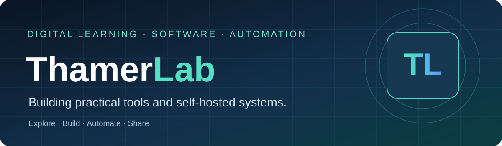

# Hi, I'm Thamer 👋

** · Builder · Self-Hosting Enthusiast**

I work at the intersection of **learning, technology, and operations** — and build practical, self-hosted tools that solve everyday problems.
ة.

## What I build

- **Self-hosted applications** — Docker, Portainer, Proxmox LXC and local-first utilities.
- **Automation and integrations** — workflows for home, productivity, and operations.
- **Practical web applications** — tools with usable interfaces and deployment documentation.
- **Digital learning experiences** — connecting operational needs with technology and knowledge management.

## Selected open-source projects

| Project | What it is | Stack / focus |
|---|---|---|
| [Watermark Studio](https://github.com/ThamerLab/watermark-studio) | Offline-first PDF watermarking with Arabic support and batch processing | JavaScript · Python · PDF |
| [CCTV Home Viewer](https://github.com/ThamerLab/CCTVHOMEVIWER) | Self-hosted home camera dashboard with WebRTC and optional HomeKit | Node.js · go2rtc · Proxmox |
| [KittenTTS Proxmox](https://github.com/ThamerLab/kittentts-proxmox) | Community LXC installer and browser UI for local text-to-speech | Python · FastAPI · Proxmox |
| [Home Assistant Collection](https://github.com/ThamerLab/Home_Assistant) | Reusable blueprints, automations and smart-home workflows | Home Assistant · YAML |
| [Safekeep](https://github.com/ThamerLab/Safekeep) | Work-in-progress receipt and warranty management application | Next.js · TypeScript · PostgreSQL |
| [Ejar Pro](https://github.com/ThamerLab/ejar-pro) | Property and rental management tailored to Saudi use cases | Python · FastAPI · Docker |

> **Project maturity varies.** Some repositories are community betas or active works in progress. Check each README for supported features, deployment requirements, and security notes.

## Tools and technologies

## My approach

**Build for real use. Document clearly. Protect user data. Keep improving.**

I'm interested in useful tools that can be run, inspected, adapted, and maintained — not just demos.

---

Built with curiosity, documented for the community. · <a href="https://github.com/ThamerLab?tab=repositories">Explore all public repositories →</a>

